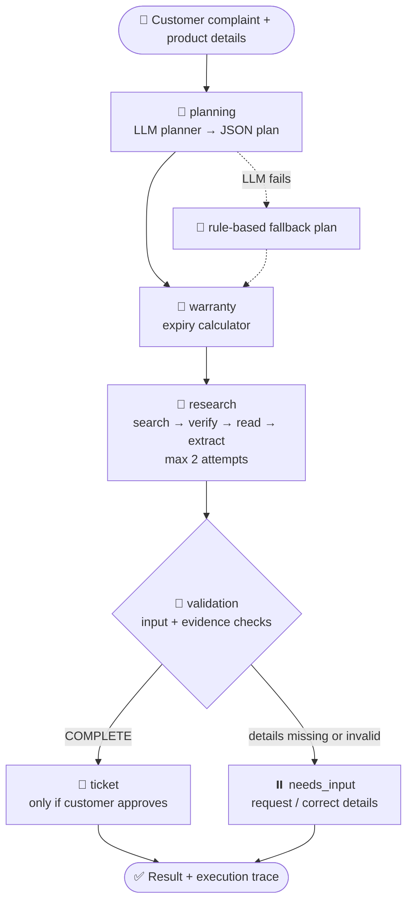
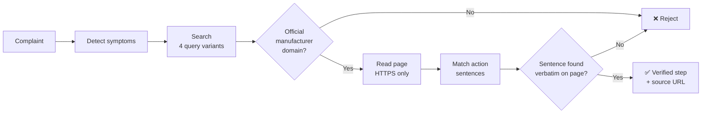

🛡️ Warranty & After-Sales Intelligence Agent


An autonomous agentic AI system that plans a customer's support case, estimates warranty coverage, researches verified manufacturer troubleshooting steps on the live web, and raises tracked support tickets, with every decision visible in a live agent trace.
🔗 Live Demo: paste your `https://<your-app>.streamlit.app` link here
Jump to: Problem · Architecture · Tools · Self-Correction · Demo · Future Work · Rubric
---
🎯 1. Why This Problem?
Imagine your laptop starts overheating. You immediately ask three things:
Customer question	Why it is hard today
❓ Is it still under warranty?	Expiry needs calendar-month arithmetic, and most people guess.
🔧 What can I try before visiting a service centre?	Search results mix official pages with forums and blogs, so safe advice is hard to spot.
🎫 How do I get it formally recorded?	Raising and tracking a request is a separate manual process.
Why not just ask a chatbot? A single LLM prompt answers fluently but cannot be trusted:
🧠 It may invent a repair step that is unsafe or irrelevant.
🌐 It is not grounded in any manufacturer document.
🔁 It has no recovery when a search or tool fails.
🧾 It leaves no audit trail to inspect.
Why agents? The task is naturally multi-step and tool-dependent: understand → plan → compute → search → verify → extract → validate → ticket. Each stage needs different tools, can fail on its own, and benefits from shared state. That is exactly what state-graph orchestration is built for.
🎓 2. Objectives and Solution
#	Objective	How it is achieved
O1	Break a complaint into an executable plan	LLM planner returns a JSON plan limited to 5 allowed actions
O2	Orchestrate multi-step execution with shared state	Typed LangGraph state machine, 6 nodes, conditional routing
O3	Use external tools and data	Live web search, domain verification, page extraction, SQLite, analytics
O4	Guarantee trustworthy output	Only exact sentences found on verified manufacturer pages are shown
O5	Handle failure gracefully	Retry loop, planner fallback, honest `INSUFFICIENT_EVIDENCE` result
O6	Remember the case	Checkpointer keyed by a per-case `thread_id` plus a running trace
O7	Make reasoning observable	Agent Activity tab with trace and structured JSON
O8	Deliver a working demo	Deployed Streamlit app on Streamlit Community Cloud
What the agent does: 🧭 plans the case → 📅 estimates warranty → 🔎 researches official sources → ✅ verifies each instruction → 🧪 validates the result → 🎫 raises a ticket only when asked → 📊 reports ticket analytics.
---
🏗️ 3. Architecture

All nodes share one typed state, persisted per case by an `InMemorySaver` checkpointer:
State group	Fields
Customer input	`customer_issue`, `customer_name`, `brand`, `purchase_date`, `warranty_months`
Agent outputs	`plan`, `warranty_result`, `research_result`, `ticket_result`
Control and observability	`create_ticket_requested`, `next_action`, `execution_trace`, `research_attempts`, `research_status`
🤖 4. Agents and Nodes
Node	Role	What it does	Rubric focus

🧭 `planning`	Planning agent	Turns the complaint into `product`, `issue`, `priority`, `planned_actions`; filters actions against an allow-list; uses a rule-based plan if the LLM fails; re-plans when a new complaint arrives	Task decomposition
📅 `warranty`	Warranty assessor	Calendar-aware expiry; returns `ESTIMATED_ACTIVE`, `ESTIMATED_EXPIRED`, `NEEDS_PURCHASE_DETAILS` or `INVALID_INPUT`	Tool execution
🔎 `research`	Research agent	Runs only when the plan includes `troubleshoot_issue`; searches, verifies sources, extracts instructions; one retry	Multi-step reasoning
🧪 `validation`	Validator	Checks inputs and evidence, logs failures and fallbacks, picks the next action	Reflection
⏸️ `needs_input`	Pause node	Ends the run when details are missing or invalid	State control
🎫 `ticket`	Ticket agent	Creates a ticket only on approval and reuses an existing one	Tool execution
Allowed planner actions: `check_warranty` · `troubleshoot_issue` · `find_service_center` · `create_support_ticket` · `analyse_claim_history`. Anything outside this list is discarded.
---
🛠️ 5. Tools
Tool	Module	Purpose
📅 Warranty estimator	`tools/customer_warranty_tool.py`	Expiry and days remaining; rejects future dates and durations outside 1–120 months
🔎 Resilient web search	`tools/web_search_tool.py`	Four query variants per case via DuckDuckGo (`ddgs`), de-duplicated
🏷️ Official-domain verifier	`tools/web_reader_tool.py`	Allow-list of manufacturer domains; rejects community, forum and third-party pages
📄 Page reader	`tools/web_reader_tool.py`	HTTPS-only retrieval and clean text extraction (`requests`, `trafilatura`)
🧪 Research engine	`agents/research_agent.py`	Symptom detection, instruction extraction, exact-match verification
🎫 Ticket manager	`tools/ticket_tool.py`	Create tickets with an idempotency key; update status `OPEN` / `IN_PROGRESS` / `RESOLVED`
📊 Ticket analytics	`analytics/ticket_analytics.py`	Totals, resolution rate, trends (SQLite + pandas)
🗂️ Product registry lookup	`tools/warranty_tool.py`	Look up registered products by brand/model or ID
Official domains: HP · Dell · Lenovo · Samsung · LG · Sony · Whirlpool · Bajaj
Recognised symptoms: 🔋 battery drain · 🔌 charging failure · 🌡️ overheating · 🌀 fan noise · 🐢 slow performance · 🖥️ display problem · 📶 network problem · 🔊 audio problem
---
🔁 6. State and Self-Correction
Short-term memory: each session gets a unique case ID used as the LangGraph `thread_id`; an execution trace records every decision, tool call and fallback.
Failure scenario	Agent response
LLM unavailable, key missing or invalid JSON	Switches to the rule-based fallback plan and logs it
LLM proposes unsupported actions	Allow-list filter discards them
Search error or no results	Automatic second attempt, then a safe message pointing to official support
Tool raises an exception	Caught, logged, retried once
Page not from an official domain	Page rejected and logged
Extracted sentence not found in the page	Sentence rejected
No verifiable instruction, or unrecognised symptom	`INSUFFICIENT_EVIDENCE` with no steps shown
Missing or invalid purchase details	Routed to `needs_input`
Repeated ticket request	Existing ticket reused
Sample trace
```
Planning agent analysed the customer complaint (LLM:llama-3.3-70b-versatile).
Warranty assessment executed: ESTIMATED_ACTIVE
Research attempt 1/2 started.
Recognised symptoms: overheating
ACCEPTED: explicit manufacturer instruction matched | ventilation | https://support.hp.com/...
Warranty validation completed: COMPLETE
```
✅ 7. Evidence Verification: Quote, Never Compose

Safeguards: official-domain allow-list · community-host filter · HTTPS only · action-pattern matching (a component mention is not an instruction) · exact-sentence check · caps of 6 pages and 6 steps · fixed LOW confidence label · mandatory warnings that the exact model is unconfirmed.
🖥️ 8. Application Interface
Tab	What it shows
🧑‍💼 Customer Assistance	Input form, warranty metrics, research status, verified steps with warnings, source links, Create Support Ticket
🔍 Agent Activity	Numbered multi-agent trace and expandable structured outputs (`plan`, `warranty_result`, `research_result`, `next_action`)
📊 Analytics Dashboard	KPIs, tickets by brand, status distribution, daily trend, filterable records, ticket-status manager
<!-- Add screenshots to a screenshots/ folder, then remove the comment markers:


---
🎬 9. Live Demonstration Guide
10-minute plan
Time	Activity	Show
0:00–1:00	Introduce problem and architecture	Graph diagram
1:00–3:30	Live scenario 1: HP laptop overheating	Warranty metrics, verified steps, sources
3:30–5:00	Agent Activity tab	Planner type, tool calls, validation lines
5:00–7:00	Edge cases	Resilience and honest failure
7:00–8:30	Ticket flow and analytics	Create, update status, dashboard
8:30–10:00	Instructor's live scenario	Run their query
Edge-case tests
#	Input	Expected behaviour	Demonstrates
1	HP, Pavilion 15, "overheats after 20 minutes"	Full workflow; steps shown only if verified, else `INSUFFICIENT_EVIDENCE`	End-to-end flow
2	"Battery drains quickly and the fan is loud"	Two symptoms recognised; unsupported ones flagged	Multi-symptom handling
3	"A key on my keyboard is missing"	`INSUFFICIENT_EVIDENCE`, no invented advice	Guardrails
4	Purchase 3 years ago, 12-month warranty	`ESTIMATED_EXPIRED`	Warranty tool
5	Brand outside the allow-list	No official pages identified, safe message	Source verification
6	Dell or Samsung product	Official-domain filtering for that brand	Tool generality
7	Empty form field	Validation message, no run	Input handling
8	Click Create Support Ticket twice	Same ticket reused	Idempotency
9	Second, different complaint in one session	New plan created	State handling
10	Remove `GROQ_API_KEY` or go offline	Fallback and retry lines in trace	Self-correction
Where the evaluator can inspect: thought process and tool logs → Agent Activity trace · structured outputs → JSON expander · final answer → Customer Assistance.
---
⚙️ 10. Setup and Deployment
```bash
git clone https://github.com/<your-username>/warranty-agent.git
cd warranty-agent
python -m venv .venv
.venv\Scripts\activate            # macOS/Linux: source .venv/bin/activate
pip install -r requirements.txt
copy .env.example .env            # macOS/Linux: cp .env.example .env
# set GROQ_API_KEY in .env (free key: https://console.groq.com/keys)
streamlit run app.py
```
Variable	Required	Default	Description
`GROQ_API_KEY`	Recommended	none	Without it the planner uses the rule-based fallback
`GROQ_MODEL`	No	`llama-3.3-70b-versatile`	Override the LLM
Deploy on Streamlit Community Cloud: push to a public GitHub repo → share.streamlit.io → Create app → branch `main`, file `app.py` → Advanced settings: Python 3.11 and secret `GROQ_API_KEY = "..."` → Deploy.
> 🔐 Keys live only in Streamlit Secrets and local `.env`, both excluded from Git.
> 💾 The SQLite database is created and seeded with **synthetic data** on first launch; Streamlit Cloud resets it when the app restarts.
Tech stack: Python 3.11 · LangGraph · Groq Llama 3.3 70B · Streamlit · DuckDuckGo (`ddgs`) · `trafilatura` · SQLite · pandas
Project structure
```
warranty-agent/
├── app.py                         # Streamlit UI (3 tabs)
├── agents/
│   ├── planning_agent.py          # LLM planner + rule-based fallback
│   ├── research_agent.py          # Live research + evidence verification
│   └── workflow.py                # LangGraph state machine
├── tools/                         # warranty, search, web reader, tickets, registry
├── analytics/                     # ticket analytics
├── database/                      # schema + synthetic seed data
├── requirements.txt
├── .env.example
└── .gitignore
```
Database tables: `products` · `claims` · `support_tickets` (synthetic) · `app_support_tickets` (real tickets created through the app)
---
🧩 11. Engineering Journey
Challenge	Decision and outcome
Need a trustworthy source	Restricted evidence to manufacturer-owned domains; rejected community pages
LLMs may fabricate steps	Switched to quote-only extraction with exact-sentence verification
Web search is unreliable	Four query variants, de-duplication, curated fallback sources, retry loop
Planner could return invalid actions	Allow-list filter plus fallback plan
Local prototype used a small Ollama model (`qwen2.5:3b`)	Moved to hosted Groq Llama 3.3 70B for cloud deployment, with a fallback so the app never depends on one provider
A second complaint reused the old plan	Plan records its source complaint and re-plans when it changes
Database file is excluded from Git	App creates and seeds the database on first run
Duplicate tickets from repeated clicks	Idempotency key per case
🚀 12. Future Improvements
Priority	Enhancement	Benefit
🔴 High	Chat interface that extracts brand, product, date and issue from free text	Faster, more natural live testing
🔴 High	Dynamic multi-tool routing with a claim-history analysis tool and a service-centre locator	Each planned action triggers its own tool
🔴 High	Model-specific verification against the exact model number	Higher confidence than the fixed LOW label
🟠 Medium	Retry that rewrites the search query instead of repeating it	Stronger self-correction
🟠 Medium	Persistent cloud database (PostgreSQL / Supabase)	Tickets survive restarts
🟠 Medium	More symptoms, manufacturers and regional support domains; streaming live trace	Broader coverage and a better demo
🟡 Low	Invoice upload with OCR · email/WhatsApp notifications · multilingual support · automated test suite	Less manual entry, closed support loop, wider access, measurable reliability
⚠️ 13. Limitations and Responsible-AI Notes
Warranty status is an estimate from customer-entered data; manufacturer registration, exclusions and claim approval are not verified.
A verified sentence proves the wording exists on the manufacturer's page, not that it fits the customer's exact model.
Troubleshooting covers the eight symptom categories above.
Web search depends on DuckDuckGo availability, and the free Groq tier has rate limits.
Seeded records are synthetic and used only for demonstration.
The system gives support guidance only; it does not diagnose faults or authorise repairs.
📋 14. Rubric Compliance
Evaluation parameter	Marks	Implementation	How to verify live
Agent Workflow & Planning	5	LLM planner → validated action plan; 6-node LangGraph with conditional routing; research runs only when planned	Agent Activity tab, architecture diagram
Tool Calling & Execution	5	Web search (4 queries), domain verifier, page reader, warranty estimator, SQLite tickets and analytics	Trace lines for search, retrieval, acceptance, rejection, ticket creation
State Management & Self-Correction	4	Checkpointed per-case state and trace; 2-attempt research loop; planner fallback; exact-match validation; ticket de-duplication; re-planning	Edge-case tests 3, 5, 8, 9, 10
Live Working Demo	6	Deployed Streamlit app with form, trace, analytics and ticket flow	Live URL at the top
👤 15. Author
	
Name	Your Name
Programme	M.Tech, Artificial Intelligence & Data Science, 9th Semester
Course	Advanced Multi-Agent Systems (MST 3 Project)
Institution	Your Institution
Contact	Your email / LinkedIn / GitHub
---
<p align="center"><i>Built to demonstrate autonomous planning, tool use, self-correction and transparent reasoning in an agentic AI system.</i></p>
