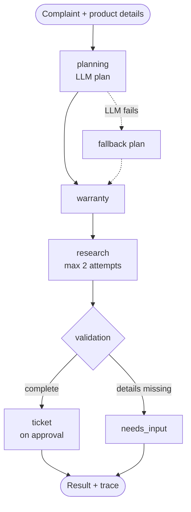

# 🛡️ Warranty & After-Sales Intelligence Agent


**An AI agent that plans a customer's support case, estimates warranty, finds verified manufacturer troubleshooting steps on the live web, and raises tracked tickets, with every decision visible in a live trace.**

🔗 **Live Demo:** https://warranty-agent-wxrjss3plojxm5e8i364xw.streamlit.app/

---

## 🎯 Why This Problem?

When a product such as a laptop or phone develops a fault, the customer usually has three questions. Each one is difficult to answer well today.

| Question | Problem today |
|---|---|
| Is my product still under warranty? | Most people guess the expiry date, because it depends on the purchase date and the warranty period |
| What can I try before a service visit? | Search results mix official support pages with forums, blogs and videos, so it is hard to know which advice is safe |
| How do I log the problem? | Raising and tracking a support request is a separate, manual process |

A normal chatbot can answer these fluently, but it has four weaknesses:

- It may **invent repair steps** that are unsafe or do not apply
- It gives **no source** for its advice
- It **cannot recover** when a search or tool fails
- It leaves **no record** of how it reached the answer

## 🎓 Objective

Build an **autonomous multi-step agent** that plans the task, chooses and runs tools, checks its own evidence, recovers from errors, and shows its reasoning to the user.

> **Key rule:** the agent *quotes, never composes*. A troubleshooting step is shown only if the exact sentence exists on a verified manufacturer page. Otherwise the agent reports `INSUFFICIENT_EVIDENCE` instead of guessing.

---

## ✅ What Has Been Built

| # | Feature | What it does |
|---|---|---|
| 1 | **AI planner** | Reads the complaint and creates a step-by-step plan in JSON format |
| 2 | **LangGraph workflow** | Six connected nodes that share one state, so each step knows what the others found |
| 3 | **Warranty estimator** | Calculates the expiry date and the days remaining, month by month |
| 4 | **Live web research** | Searches the internet using four different query variations |
| 5 | **Source verification** | Accepts only official manufacturer websites and rejects forums and blogs |
| 6 | **Evidence check** | Shows a step only if its exact sentence is found on the page |
| 7 | **Self-correction** | Retries, switches to a fallback and reports honestly when a tool fails |
| 8 | **Ticket system** | Creates, updates and de-duplicates support tickets in SQLite |
| 9 | **Analytics dashboard** | Shows ticket totals, status split and daily trend |
| 10 | **Agent trace** | Displays every decision and tool call so the reasoning can be inspected |
| 11 | **Cloud deployment** | Hosted publicly on Streamlit Community Cloud |

## 🧠 How It Works

1. The customer enters the product details, purchase date and the problem.
2. The **planner** turns the complaint into a plan.
3. The **warranty** step estimates whether the product is covered.
4. The **research** step searches the web, keeps only official pages, and extracts the instructions.
5. The **validation** step checks the result and decides what happens next.
6. If the customer asks for it, a **ticket** is created.
7. The full trace is shown in the **Agent Activity** tab.

### Example

> **Input:** HP Pavilion 15, bought 8 months ago with a 12-month warranty. *"My laptop overheats after 20 minutes."*
>
> **Output:** warranty estimated as **active** with about 4 months left, verified manufacturer steps with their source links (or `INSUFFICIENT_EVIDENCE` if none can be verified), and an option to create a support ticket.

---

## 🏗️ Architecture

The diagram shows how a case moves through the system. Solid arrows are the normal path. Dotted arrows are fallbacks.



State is shared through a typed **LangGraph** `StateGraph` and saved for each case with a checkpointer (`thread_id` = case ID). This is how the agent remembers what it has already done in a case.

## 🤖 Workflow Nodes

| Node | Role |
|---|---|
| `planning` | Creates the plan using only allowed actions; uses a fallback plan if the LLM fails; plans again for every new complaint |
| `warranty` | Estimates warranty status: active, expired, or needs more details |
| `research` | Runs only if troubleshooting is planned; searches, verifies sources, extracts steps; retries once on failure |
| `validation` | Checks inputs and evidence, and records any failure or fallback in the trace |
| `needs_input` | Stops and asks the customer when information is missing or invalid |
| `ticket` | Creates a ticket only after approval and never creates duplicates |

## 🛠️ Tools

| Tool | Purpose |
|---|---|
| Warranty estimator | Expiry date and days remaining; rejects future dates and invalid periods |
| Web search | Four live DuckDuckGo query variations, with duplicates removed |
| Domain verifier | Official domains only: HP, Dell, Lenovo, Samsung, LG, Sony, Whirlpool, Bajaj |
| Page reader | HTTPS-only retrieval and clean text extraction |
| Ticket manager | SQLite tickets with status updates: Open, In Progress, Resolved |
| Analytics | Open count, resolved count and resolution rate |

**Issues the agent understands:** battery drain · charging · overheating · fan noise · slow performance · display · network · audio

## 🔁 Self-Correction

Real tools fail. This table shows how the agent responds instead of crashing or guessing.

| If this happens | The agent does this |
|---|---|
| LLM or API key unavailable | Switches to a rule-based fallback plan and logs it |
| Search error or no results | Retries once, then points the customer to official support |
| Page is not official, or the sentence is not on the page | Rejects it |
| No verifiable step found | Shows `INSUFFICIENT_EVIDENCE` and gives no advice |
| Purchase details missing | Pauses and asks for input |
| Ticket button clicked twice | Reuses the same ticket |
| New complaint in the same session | Creates a fresh plan |

**What the trace looks like in the app:**

```
Planning agent analysed the customer complaint (LLM:llama-3.3-70b-versatile).
Warranty assessment executed: ESTIMATED_ACTIVE
Research attempt 1/2 started.
Recognised symptoms: overheating
Warranty validation completed: COMPLETE
```

---

## 🖥️ App Screens

| Tab | What it shows |
|---|---|
| **Customer Assistance** | Input form, warranty result, verified steps with sources, and the ticket button |
| **Agent Activity** | Step-by-step trace of the agent and the structured JSON outputs |
| **Analytics Dashboard** | Ticket KPIs, charts, filters and a status manager |

## 🧰 Tech Stack

| Layer | Technology |
|---|---|
| Language | Python 3.11 |
| Agent framework | LangGraph |
| LLM | Groq, Llama 3.3 70B |
| Interface | Streamlit |
| Search and extraction | DuckDuckGo (`ddgs`), `trafilatura`, `requests` |
| Database and data | SQLite, pandas |
| Hosting | Streamlit Community Cloud |

## 📁 Project Structure

```
warranty-agent/
├── app.py                    # Streamlit app (3 tabs)
├── agents/
│   ├── planning_agent.py     # LLM planner + fallback
│   ├── research_agent.py     # Live research + evidence checks
│   └── workflow.py           # LangGraph workflow
├── tools/                    # Warranty, search, web reader, tickets
├── analytics/                # Ticket analytics
├── database/                 # Schema + synthetic demo data
├── requirements.txt
├── .env.example
└── .gitignore
```

---

## 🎬 Demo Script

Try these inputs in the live app to see each behaviour.

| # | Try this | What it shows |
|---|---|---|
| 1 | HP, Pavilion 15, "overheats after 20 minutes" | Full workflow with sources |
| 2 | "Battery drains and fan is loud" | Multiple symptoms handled together |
| 3 | "A keyboard key is missing" | No invented advice |
| 4 | Purchase 3 years ago, 12-month warranty | Expired status |
| 5 | A brand outside the supported list | Source verification |
| 6 | Click Create Support Ticket twice | No duplicate tickets |
| 7 | Remove the API key | Fallback shown in the trace |

## 🚀 Run and Deploy

**Run locally**

```bash
pip install -r requirements.txt
copy .env.example .env      # add GROQ_API_KEY (free at console.groq.com)
streamlit run app.py
```

**Deploy on Streamlit Cloud:** push to GitHub → share.streamlit.io → main file `app.py` → Python 3.11 → add secret `GROQ_API_KEY`.

The database is created and filled with synthetic demo data automatically on first run.

---

## 🔮 Future Improvements

Every improvement below addresses a current limitation of the system and describes how it can be solved.

| Area | Current limitation | Proposed solution |
|---|---|---|
| **Customer support contact** | When no verified step is found, or the warranty has expired, the agent can only point to "official support" in general terms | Add a **customer-care directory** with the toll-free number, email and service-centre link for each brand and appliance type, shown automatically in these cases |
| **Input** | The customer must fill in a form manually | Add a **chat interface** that extracts brand, product, purchase date and issue from free text, plus **invoice upload with OCR** to read the purchase date and warranty period |
| **Warranty accuracy** | Warranty is an estimate based on customer input and is not verified with the manufacturer | Integrate **manufacturer warranty lookup by serial number** where official services exist |
| **Tool usage** | Tools run in a fixed order; claim-history and service-centre actions can be planned but are not executed | Add **dynamic tool routing** so each planned action triggers its own tool, including a **claim-history analysis** tool and a **service-centre locator** by city |
| **Coverage** | Eight issue types and eight manufacturers are supported | Extend symptom categories and brand list, add **regional support domains**, and use the LLM to classify symptoms while keeping quote-only verification |
| **Accuracy of advice** | A verified sentence proves the wording exists on the page, not that it fits the exact model | Add **model-specific verification** against the model number found on the page |
| **Self-correction** | A retry repeats the same search | Add a **query-rewriting retry** that broadens or narrows the search before trying again |
| **Data storage** | Tickets are stored locally and reset when the cloud app restarts | Move to a **persistent cloud database** such as PostgreSQL or Supabase |
| **Communication** | Customers are not notified about ticket updates | Send **email or WhatsApp notifications** when a ticket status changes |
| **Language** | The interface and guidance are in English only | Add **multilingual support**, starting with Hindi |
| **Reliability** | Testing is manual | Add an **automated test suite** covering the edge cases in the demo script |

> **Note:** the agent provides support guidance only. It does not diagnose faults or approve repairs, and the seeded demo data is synthetic.

---

## 👤 Author

**Your Name** · M.Tech AI & Data Science, 9th Semester · Advanced Multi-Agent Systems · _Your Institution_
