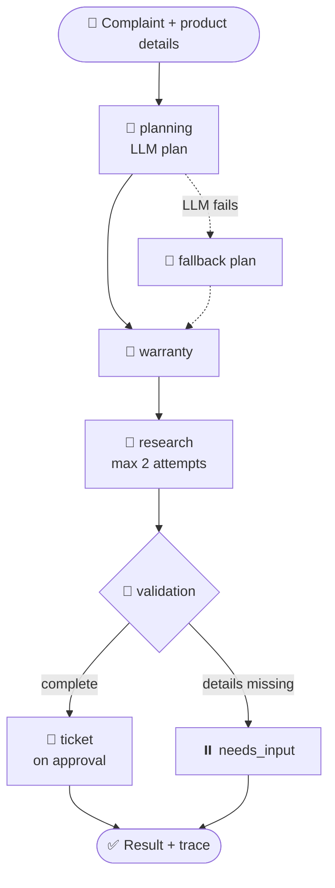

# 🛡️ Warranty & After-Sales Intelligence Agent


**An AI agent that plans a customer's support case, estimates warranty, finds verified manufacturer troubleshooting steps on the live web, and raises tracked tickets, with every decision visible in a live trace.**

🔗 **Live Demo:** https://warranty-agent-wxrjss3plojxm5e8i364xw.streamlit.app/

---

## 🎯 Why This Problem?

When a product breaks, customers ask three things. Today each one is hard to answer:

| Question | Problem today |
|---|---|
| ❓ Is my product still under warranty? | Most people guess the expiry date |
| 🔧 What can I try before a service visit? | Search mixes official pages with forums and blogs |
| 🎫 How do I log the problem? | Raising and tracking a request is a manual process |

A normal chatbot can answer these fluently, but it may **invent unsafe repair steps**, gives **no source**, **cannot recover** when a search fails, and leaves **no record** of how it decided.

## 🎓 Objective

Build an **autonomous multi-step agent** that plans the task, chooses and runs tools, checks its own evidence, recovers from errors, and shows its reasoning to the user.

> **Key rule:** the agent *quotes, never composes*. A troubleshooting step is shown only if the exact sentence exists on a verified manufacturer page. Otherwise it reports `INSUFFICIENT_EVIDENCE` instead of guessing.

---

## ✅ What Has Been Built

| # | Feature | What it does |
|---|---|---|
| 1 | 🧭 **AI planner** | Reads the complaint and creates a step-by-step plan (JSON) |
| 2 | 🔗 **LangGraph workflow** | Six connected nodes that share one state |
| 3 | 📅 **Warranty estimator** | Calculates expiry date and days remaining |
| 4 | 🔎 **Live web research** | Searches the internet with four query variations |
| 5 | 🏷️ **Source verification** | Accepts only official manufacturer websites |
| 6 | ✅ **Evidence check** | Shows a step only if its exact sentence is on the page |
| 7 | 🔁 **Self-correction** | Retries, falls back and reports honestly when tools fail |
| 8 | 🎫 **Ticket system** | Creates, updates and de-duplicates support tickets (SQLite) |
| 9 | 📊 **Analytics dashboard** | Shows ticket totals, status and trends |
| 10 | 🔍 **Agent trace** | Displays every decision and tool call live |
| 11 | ☁️ **Cloud deployment** | Hosted on Streamlit Community Cloud |

## 🧠 How It Works

1. 👤 The customer enters product details, purchase date and the problem.
2. 🧭 The **planner** turns the complaint into a plan.
3. 📅 The **warranty** step estimates coverage.
4. 🔎 The **research** step searches, keeps only official pages, and extracts instructions.
5. 🧪 The **validation** step checks the result and decides what happens next.
6. 🎫 If the customer asks, a **ticket** is created.
7. 🔍 The full trace is shown in the **Agent Activity** tab.

---

## 🏗️ Architecture



State is shared through a typed **LangGraph** `StateGraph` and saved per case with a checkpointer (`thread_id` = case ID).

## 🤖 Workflow Nodes

| Node | Role |
|---|---|
| 🧭 `planning` | Creates the plan; allowed actions only; uses a fallback plan if the LLM fails; re-plans for every new complaint |
| 📅 `warranty` | Estimates warranty status: active, expired, or needs details |
| 🔎 `research` | Runs only if troubleshooting is planned; searches, verifies sources, extracts steps; retries once |
| 🧪 `validation` | Checks inputs and evidence and records failures in the trace |
| ⏸️ `needs_input` | Stops and asks for details when information is missing or invalid |
| 🎫 `ticket` | Creates a ticket only on approval and never duplicates |

## 🛠️ Tools

| Tool | Purpose |
|---|---|
| 📅 Warranty estimator | Expiry date and days remaining |
| 🔎 Web search | Four live DuckDuckGo query variants |
| 🏷️ Domain verifier | Official domains only: HP, Dell, Lenovo, Samsung, LG, Sony, Whirlpool, Bajaj |
| 📄 Page reader | HTTPS-only text extraction |
| 🎫 Ticket manager | SQLite tickets with status updates |
| 📊 Analytics | Open, resolved and resolution rate |

**Issues the agent understands:** 🔋 battery drain · 🔌 charging · 🌡️ overheating · 🌀 fan noise · 🐢 slow performance · 🖥️ display · 📶 network · 🔊 audio

## 🔁 Self-Correction

| If this happens | The agent does this |
|---|---|
| LLM or API key unavailable | Uses a rule-based fallback plan |
| Search error or no results | Retries once, then points to official support |
| Page is not official, or the sentence is not on the page | Rejects it |
| No verifiable step found | Shows `INSUFFICIENT_EVIDENCE` and gives no advice |
| Purchase details missing | Pauses and asks for input |
| Ticket button clicked twice | Reuses the same ticket |
| New complaint in the same session | Creates a fresh plan |

---

## 🖥️ App Screens

| Tab | What it shows |
|---|---|
| 🧑‍💼 **Customer Assistance** | Input form, warranty result, verified steps, sources, ticket button |
| 🔍 **Agent Activity** | Step-by-step trace and structured JSON outputs |
| 📊 **Analytics Dashboard** | Ticket KPIs, charts, filters and status manager |

## 🧰 Tech Stack

| Layer | Technology |
|---|---|
| Language | Python 3.11 |
| Agent framework | LangGraph |
| LLM | Groq, Llama 3.3 70B |
| Interface | Streamlit |
| Search and extraction | DuckDuckGo (`ddgs`), `trafilatura`, `requests` |
| Database and data | SQLite, pandas |
| Hosting | Streamlit Community Cloud |

## 📁 Project Structure

```
warranty-agent/
├── app.py                    # Streamlit app (3 tabs)
├── agents/
│   ├── planning_agent.py     # LLM planner + fallback
│   ├── research_agent.py     # Live research + evidence checks
│   └── workflow.py           # LangGraph workflow
├── tools/                    # Warranty, search, web reader, tickets
├── analytics/                # Ticket analytics
├── database/                 # Schema + synthetic demo data
├── requirements.txt
├── .env.example
└── .gitignore
```

---

## 🎬 Demo Script

| # | Try this | What it shows |
|---|---|---|
| 1 | HP, Pavilion 15, "overheats after 20 minutes" | Full workflow with sources |
| 2 | "Battery drains and fan is loud" | Multiple symptoms |
| 3 | "A keyboard key is missing" | No invented advice |
| 4 | Purchase 3 years ago, 12-month warranty | Expired status |
| 5 | A brand outside the supported list | Source verification |
| 6 | Create a ticket twice | No duplicates |
| 7 | Remove the API key | Fallback shown in the trace |

## 🚀 Run and Deploy

```bash
pip install -r requirements.txt
copy .env.example .env      # add GROQ_API_KEY (free at console.groq.com)
streamlit run app.py
```

**Streamlit Cloud:** push to GitHub → share.streamlit.io → main file `app.py` → Python 3.11 → add secret `GROQ_API_KEY`.

## 🔮 Future Improvements

| Priority | Idea |
|---|---|
| 🔴 High | Chat interface that reads details from free text |
| 🔴 High | Dynamic tool routing, claim-history tool, service-centre locator |
| 🟠 Medium | Query-rewriting retry, persistent cloud database, model-specific verification |
| 🟡 Low | Invoice OCR, email alerts, multilingual support, automated tests |

## ⚠️ Limitations

Warranty is an **estimate** from customer input. Verified sentences prove the wording, not that it fits the exact model. Seeded data is **synthetic**. The tool gives support guidance only.

## 👤 Author

**Your Name** · M.Tech AI & Data Science, 9th Semester · Advanced Multi-Agent Systems · _Your Institution_
