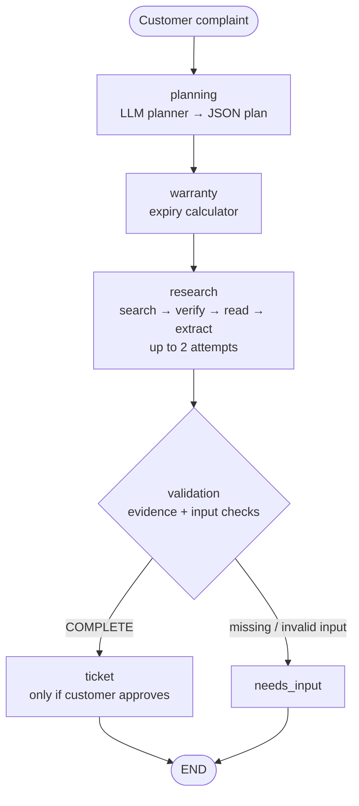

# 🛡️ Warranty & After-Sales Intelligence Agent

A multi-agent AI system that takes a customer's product complaint, estimates warranty coverage, researches **verified manufacturer troubleshooting steps** on the live web, and can raise an internal support ticket. Built with **LangGraph**, **Groq (Llama 3.3 70B)** and **Streamlit**.

**Live demo:** _add your `https://<your-app>.streamlit.app` link here_

> The agent never invents repair steps. Every suggested step is an exact sentence copied from a retrieved manufacturer page, and if no such sentence exists the system says so instead of guessing.

---

## Architecture



State is shared through a typed LangGraph `StateGraph` and persisted per case with an `InMemorySaver` checkpointer (`thread_id` = case id).

## Rubric mapping

| Rubric item | Where it lives |
|---|---|
| **Agent workflow & planning** | `agents/planning_agent.py` (LLM turns the complaint into a JSON plan limited to 5 allowed actions) and `agents/workflow.py` (6-node LangGraph with a conditional edge after validation) |
| **Tool calling & execution** | `tools/`: warranty calculator, DuckDuckGo search (4 query variants), official-domain verifier, web page reader (trafilatura), SQLite ticket tool; `analytics/`: ticket metrics |
| **State management & self-correction** | Checkpointed state + execution trace; research retried once on failure; planner falls back to a rule-based plan if the LLM fails; unsupported advice is blocked as `INSUFFICIENT_EVIDENCE` |
| **Live working demo** | Streamlit app: *Customer Assistance*, *Agent Activity* (full trace + structured JSON), *Analytics Dashboard* |

## Tools

| Tool | File | Purpose |
|---|---|---|
| `assess_customer_warranty` | `tools/customer_warranty_tool.py` | Calendar-month expiry and days remaining; rejects invalid or future dates |
| `resilient_web_search` | `tools/web_search_tool.py` | Runs several live DuckDuckGo queries, de-duplicates results |
| `is_official_domain` / `read_webpage` | `tools/web_reader_tool.py` | Accepts only HTTPS manufacturer domains; community and third-party pages are rejected |
| `research_and_troubleshoot` | `agents/research_agent.py` | Detects symptoms, extracts explicit action sentences, verifies each against the page text |
| `create_support_ticket` / `update_ticket_status` | `tools/ticket_tool.py` | SQLite tickets with an idempotency key (no duplicates) |
| `get_ticket_metrics` | `analytics/ticket_analytics.py` | Open / resolved counts and resolution rate |

## Self-correction and fallbacks

- **Planner failure** (no key, rate limit, bad JSON): switches to a rule-based plan and records it in the trace.
- **Research failure** (`SEARCH_FAILED`, `NO_RESULTS`, `AI_FAILED`, `RESEARCH_FAILED`): one automatic retry, then a safe message that points to official support.
- **Evidence validation**: a step is shown only if the exact sentence is found in a verified manufacturer page; otherwise the result is `INSUFFICIENT_EVIDENCE` with no steps.
- **Duplicate tickets** are prevented per case.
- **New complaint in the same session** triggers a fresh plan.

## Run locally

```bash
python -m venv .venv
.venv\Scripts\activate            # macOS/Linux: source .venv/bin/activate
pip install -r requirements.txt
copy .env.example .env            # macOS/Linux: cp .env.example .env
# put your free Groq key in .env  (https://console.groq.com/keys)
streamlit run app.py
```

The SQLite database (`database/warranty.db`) is created and filled with **synthetic demo data** automatically on first run.

## Deploy on Streamlit Community Cloud

1. Push this folder to a public GitHub repo (`.env` and `*.db` are git-ignored).
2. Go to https://share.streamlit.io → **Create app** → pick the repo, branch `main`, main file `app.py`.
3. **Advanced settings** → Python version **3.11** → paste the secret: `GROQ_API_KEY = "..."`.
4. Deploy, then add the app URL at the top of this README.

> Tickets are stored in SQLite on the app's local disk, which Streamlit Cloud resets when the app restarts.

## Demo script

1. **Happy path**: Brand `HP`, product `Pavilion 15`, issue "laptop overheats after 20 minutes". Open *Agent Activity* to show planning → warranty → research → validation, the accepted manufacturer sentences, and their source URLs.
2. **Multiple symptoms**: "battery drains quickly and the fan is loud".
3. **Unsupported issue**: "keyboard key is missing" → `INSUFFICIENT_EVIDENCE`, no invented steps.
4. **Expired warranty**: purchase date 3 years ago with 12 months of cover → `ESTIMATED_EXPIRED`.
5. **Another brand**: Dell or Samsung → shows the official-domain filtering.
6. **Incomplete form**: leave a field empty → validation message.
7. **Ticket flow**: *Create Support Ticket* → *Analytics Dashboard* → change status to `RESOLVED`.
8. **Resilience**: remove `GROQ_API_KEY` or disconnect the internet → fallback entries appear in the trace.

## Project layout

```
├── app.py                      # Streamlit UI (3 tabs)
├── agents/
│   ├── planning_agent.py       # LLM planner + rule-based fallback
│   ├── research_agent.py       # live research + evidence verification
│   └── workflow.py             # LangGraph state machine
├── tools/                      # warranty, search, web reader, tickets
├── analytics/                  # ticket analytics
├── database/                   # schema + synthetic seed data
├── requirements.txt
├── .env.example
└── .gitignore
```

## Limitations

- Warranty status is an **estimate** from customer-entered dates; manufacturer eligibility is not verified.
- Troubleshooting covers 8 symptom categories (battery, charging, overheating, fan noise, slow performance, display, network, audio).
- Verified sentences show correct source wording, not that they apply to the exact model.
- Seed data is synthetic.
